<!-- Header: animated cartoon mountain valley (needs header.svg in the repo root) -->
<p align="center">
  
</p>

<!-- Typing animation -->
<p align="center">
  
</p>

<p align="center">
  
  
  
</p>

---

## 🏔️ About

```js
const suman = {
  role: "Junior Full Stack Developer",
  education: "BIM graduate",
  focus: ["React", "Node.js", "Backend Architecture"],
  mindset: "Understand the fundamentals. Build. Improve.",
};
```

## 🛠️ Stack

<p align="center">
  
</p>

## 🐍 Contribution Snake

<p align="center">
  
</p>

## 🤝 Connect

<p align="center">
  <a href="https://www.linkedin.com/in/suman-dangol-9310b6306/"></a>
  <a href="https://sumandongol.vercel.app/"></a>
</p>

<!-- Footer: green valley into sky blue -->
<p align="center">
  
</p>
